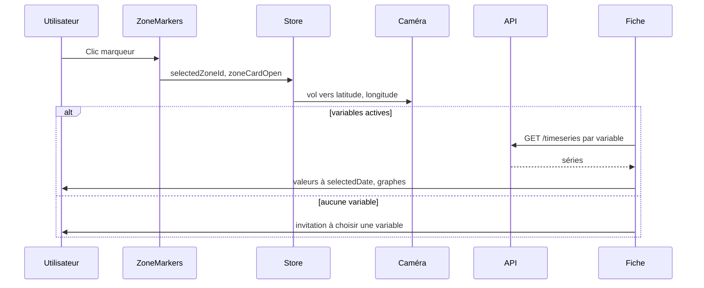
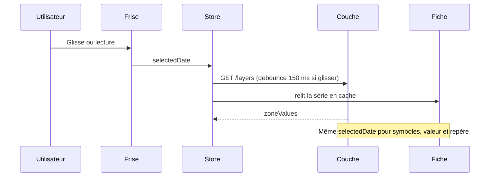
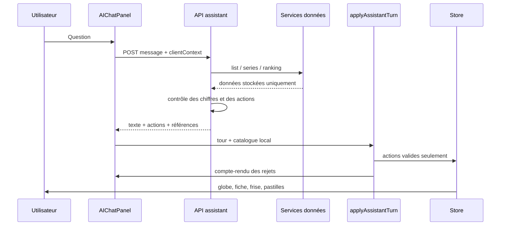

# EarthScope — Blueprint d’implémentation

Document de référence partagé entre produit, frontend, backend, visualisation géospatiale et intégration IA. Il opérationnalise la description frontend v3. Il ne contient pas de code applicatif.

L’interface livrée est spécifiée dans [earthscope-frontend.md](earthscope-frontend.md). Ce document prévaut pour le frontend, en particulier le fond de globe : Cesium ion lorsque la clé Map Tiles API est absente, tuiles Google lorsqu’elle est renseignée.

Légende utilisée dans tout le document :

- **[Brief]** exigence explicite de la description v3 ou des règles produit.
- **[Décision]** choix retenu pour que l’implémentation ne reste pas ouverte. Il est appliqué partout dans ce blueprint.
- **[Hypothèse]** défaut technique là où le brief ne donne pas de valeur. Elle est remplaçable sans changer le contrat, tant que le champ backend correspondant reste la source de vérité.
- Les questions encore ouvertes sont uniquement dans le livrable 10. Elles ont déjà une recommandation.

Les noms d’entités sont stables : **zone**, **variable**, **observation**, **série temporelle**, **tendance**, **couche**, **session de conversation**, **action d’assistant**. Une variable n’est pas une mesure. Une tendance n’est pas une série. Une couche n’est pas une observation.

Les exemples JSON portent le champ `"_notice": "STRUCTURE ILLUSTRATIVE. Les nombres ne sont pas des mesures d’observation de la Terre."` Toute valeur numérique d’exemple est un placeholder de contrat, jamais une donnée scientifique.

Langue de l’interface du prototype : français. Les chaînes visibles sont externalisées dans un catalogue `fr`. Les identifiants d’API, les champs JSON et le code restent en anglais.

---

# DELIVERABLE 1 — Product specification

## 1.1 Proposition de valeur

**[Brief]** EarthScope est un poste de travail d’observation de la Terre. Le globe occupe l’écran. L’utilisateur explore la planète, restreint son analyse à des zones fournies par le backend (des villes dans le prototype), active des variables environnementales, lit leur valeur et leur tendance, se déplace dans le temps, et peut confier cette manipulation à un assistant qui agit sur l’interface par des actions structurées.

Ce n’est pas un site vitrine, ni un tableau de bord de graphiques, ni un clone de l’interface Google Earth. Le globe et son arrière-plan spatial sont ceux de Google Earth. L’interface autour est celle d’EarthScope.

## 1.2 Décision de globe — verrouillée

**[Décision D-GLOBE]** Le globe est rendu par CesiumJS avec les **Photorealistic 3D Tiles** de la Map Tiles API Google (`https://tile.googleapis.com/v1/3dtiles/root.json`). Le globe ellipsoïde par défaut de Cesium est masqué (`globe: false`). L’atmosphère est réactivée (`scene.skyAtmosphere.show = true`). Le fond est le ciel étoilé de Cesium (`skyBox`) plus le limbe atmosphérique.

Ce choix est le seul moyen légal d’afficher **la** Terre de Google (même mesh, même imagerie) dans une application tierce. Scraper `earth.google.com`, embarquer Earth Web dans une iframe, ou recopier ses textures de ciel est exclu.

Ce que cela garantit :

- La surface, le relief, l’imagerie satellite et les bâtiments photogrammétriques sont les tuiles Google, les mêmes que Google Earth.
- Vu de l’espace, on voit un disque terrestre Google, un limbe bleu et un fond noir étoilé.
- Les attributions Google renvoyées dans les tuiles restent affichées en permanence (`showCreditsOnScreen: true`). Elles ne sont jamais masquées.

Limite assumée, à ne pas « corriger » en copiant des assets Google :

- Le champ d’étoiles est celui de Cesium, pas la texture propriétaire du ciel d’Earth Web. La composition visuelle est la même (espace noir, étoiles, limbe). Les positions d’étoiles ne sont pas celles du shader Google.
- Les nuages animés et le terminateur jour/nuit ne font pas partie des Photorealistic 3D Tiles, ni de la vue par défaut d’Earth Web (la capture de référence est un disque pleinement éclairé, sans couche nuageuse). Ils sont **éteints**. Les ajouter inventerait une couche qui n’est pas Google Earth.
- Les labels de pays et de villes dessinés par Earth Web ne sont pas dans ces tuiles. EarthScope ne les réinjecte pas. Les seuls noms posés sur le globe sont les marqueurs de zones EarthScope.

Contraintes d’usage, non négociables :

- Clé Map Tiles API restreinte par referrer. Variable `VITE_GOOGLE_MAPS_API_KEY`. Facturation Google activée. La clé n’est pas un secret backend : les tuiles sont chargées par le navigateur, comme l’exige le renderer. Aucun proxy de tuiles (interdit par les règles de cache Google, et inutilement coûteux).
- Pas de cache applicatif des tuiles au-delà des en-têtes HTTP Google.
- Aucune donnée EarthScope n’est dérivée de l’imagerie (pas de tracé, pas de modèle entraîné sur les tuiles, pas de MNT reconstruit depuis le mesh).
- La barre d’état sépare les sources : « Fond : Google · Données : EarthScope ».

Si la clé est absente, le WebGL indisponible, ou le tileset en erreur : l’écran de globe affiche un échec explicite et un bouton Réessayer. Pas de globe de substitution (pas de Sentinel, pas de style cartoon, pas d’image fixe). Un autre fond violerait l’exigence « exactement Google Earth ».

## 1.3 Parcours principaux

1. **Ouvrir et regarder.** L’utilisateur arrive sur la Terre Google, sans variable, sans zone, avec la frise à sa date par défaut. Il tourne le globe partout, y compris hors couverture.
2. **Choisir une zone.** Marqueur, recherche ou liste. Vol de caméra, fiche ouverte. Sans variable active, la fiche invite à en choisir une.
3. **Activer une variable.** La couleur d’identité et l’échelle colorée apparaissent. Les zones qui ont une observation changent de symbole. La fiche affiche valeur, tendance et graphique. Les zones sans donnée le disent.
4. **Activer plusieurs variables.** Une variable est primaire (symbole de surface / remplissage). Les autres sont secondaires (anneau). Les graphiques restent séparés, car les unités diffèrent.
5. **Se déplacer dans le temps.** La date unique met à jour les symboles, la valeur courante et le repère des graphiques. Lecture jusqu’au bout de la période, puis arrêt.
6. **Demander à l’assistant.** La question produit un texte et des actions. L’interface change visiblement. L’assistant énonce ce qu’il a activé. L’utilisateur peut tout modifier ensuite à la main.
7. **Comparer.** À partir de la phase 4, une question de classement ou de comparaison active la variable, met en évidence les zones concernées et affiche un classement. Pas un second globe.

## 1.4 Modes d’interaction

- **Manipulation directe** : globe, marqueurs, cases de variables, frise, fiche.
- **Recherche de zone** : uniquement le catalogue backend.
- **Assistant** : langage naturel → actions validées. Jamais de code arbitraire.
- Les deux derniers modes écrivent dans le **même** état (zone, variables, date). Aucun mode parallèle.

## 1.5 États fondamentaux

| État | Signification |
|---|---|
| `boot` | Coque visible, globe et catalogue en cours |
| `ready` | Globe navigable et catalogue reçu, même si l’un des deux a échoué séparément |
| `exploring` | Aucune zone, aucune variable |
| `zone-selected` | Une zone, fiche ouverte |
| `variable-active` | Au moins une variable active |
| `playing` | La frise avance |
| `degraded` | Globe ou API en erreur, le reste reste utilisable |
| `blocked` | WebGL absent : message plein écran, pas de fausse carte |

## 1.6 Dépendances entre éléments

```text
catalogue zones/variables  → marqueurs, panneaux, validation des actions IA
zone sélectionnée          → vol caméra, fiche, séries demandées
variables actives          → couche, légendes, pastilles, graphiques de la fiche, contexte IA
variable primaire          → remplissage des symboles et légende d’échelle
date sélectionnée          → couche du jour, valeur lue dans la série, curseur des graphiques, contexte IA
lecture                    → n’écrit que la date, à intervalle régulier
actions IA                 → passent par le même reducer que les clics
```

La caméra n’est pas une donnée serveur. Elle ne change pas la date, ni la variable, ni la zone, sauf quand la sélection d’une zone déclenche un vol.

## 1.7 Qui fait quoi

| Fonction | Où |
|---|---|
| Rendu du globe Google, caméra, atmosphère, étoiles, attributions | Frontend + Map Tiles API |
| Liste des zones, variables, catégories, alias, unités, couleurs, couvertures | Backend, jamais en dur dans le client |
| Observations, séries, tendances, classements, comparaisons | Backend |
| Accrochage d’une date sur la grille temporelle, dérivation min/max de la frise à partir des métadonnées | Frontend |
| Régression statistique | Backend uniquement |
| Interprétation du langage et rédaction | Service d’assistant, derrière l’API EarthScope |
| Validation finale des actions et application à l’écran | Frontend, une seconde fois, sur le catalogue qu’il a chargé |
| Géocodage du monde entier | Hors prototype. La recherche ne connaît que les zones du catalogue |

---

# DELIVERABLE 2 — Requirements matrix

Priorités : **P0** prototype utilisable, **P1** première version complète, **P2** suite.

| ID | Feature | Description | Priority | Frontend | Backend | Completion criteria |
|---|---|---|---|---|---|---|
| F-01 | Globe Google | Tuiles 3D photoréalistes, atmosphère, ciel étoilé, attributions visibles | P0 | Cesium, pas de globe de repli | Aucun, hors clé Google | Disque terrestre Google navigable, étoiles et limbe visibles, crédits à l’écran |
| F-02 | Navigation | Glisser, molette, inclinaison, zoom ±, boussole vers la vue initiale, plein écran | P0 | Contrôleur caméra + Fullscreen API | Aucun | Chaque geste produit l’effet décrit au §2.9 et §7 |
| F-03 | Barre d’état | Coordonnées, altitude, échelle, sources | P0 | Lecture caméra Cesium | Aucun | Les valeurs suivent la caméra et le curseur sans rerendu général |
| F-04 | Catalogue zones | Zones backend avec id, nom, pays, coordonnées, variables disponibles | P0 | Affichage et cache | `GET /zones` | Aucune ville écrite dans le code frontend |
| F-05 | Marqueurs | Toutes les zones sur le globe, nom à partir d’un seuil de hauteur caméra | P0 | BillboardCollection | Catalogue | Chaque zone du catalogue a un marqueur cliquable |
| F-06 | Clic hors zone | Aucune sélection, message discret | P0 | Hit-test | Aucun | Le clic dans l’océan ne change pas `selectedZoneId` |
| F-07 | Sélection zone | Marqueur, liste ou recherche : vol, surbrillance, fiche | P0 | Caméra + fiche | Catalogue déjà chargé | Les trois entrées aboutissent au même état |
| F-08 | Recherche limitée | Suggestions limitées au catalogue ; lieu inconnu annoncé | P0 | Filtre local accent-insensible | `q` prévu si le catalogue est paginé | « Paris » sans zone Paris n’ouvre aucune fiche |
| F-09 | Catalogue variables | Thèmes, unité, description, couleur, disponibilité | P0 | Panneau | `GET /variables` | Décocher toutes les variables restaure le globe nu |
| F-10 | Multi-variables | Une primaire en remplissage, les autres en anneau | P0 | État + légendes | Couche et séries | Deux variables restent distinguables sans mélange d’unités |
| F-11 | Couche à une date | Symboles colorés uniquement où une observation existe | P0 | Rendu symboles | `GET /layers` | Une zone sans observation n’est pas colorée par interpolation |
| F-12 | Légende | Rampe, min, max, unité, mention « valeur au point » | P0 | Composant légende | `displayScale` de la variable | La légende utilise la couleur d’identité de la variable |
| F-13 | Pastilles actives | Toujours visibles, croix de retrait, clic = rendre primaire | P0 | Composant | Aucun | Retirer la dernière variable rend le globe nu |
| F-14 | Fiche zone | Nom, pays, coordonnées, puis une section par variable active | P0 | Panneau | Séries | Sans variable : invitation. Sans donnée : phrase explicite, pas de graphe vide |
| F-15 | Série et tendance | Graphe, ligne de tendance, variation, survol | P0 | Graphe | `GET /timeseries` | Le repère vertical est sur `selectedDate` |
| F-16 | Frise | Plage, curseur, pas, lecture, vitesses, butées | P0 | Contrôle temporel | Métadonnées de couverture | Jouer jusqu’à la fin arrête ; globe, fiche et graphes montrent la même date |
| F-17 | Sync de la date | Une date pour toute l’application | P0 | Store | Lectures par date | Aucun composant ne conserve sa propre date |
| F-18 | Disposition | Outils à gauche, fiche en haut droite, frise en bas, mobile en feuilles | P0 | Layout | Aucun | À 390 px la barre est en bas et un seul panneau est ouvert |
| F-19 | Accessibilité | Clavier, noms accessibles, focus, contraste, réduction des animations | P0 | UI | Aucun | Le parcours zone → variable → date est faisable au clavier |
| F-20 | États d’échec | API, tuiles, WebGL, donnée manquante, action IA invalide | P0 | États visuels | Erreurs normalisées | Aucune valeur inventée pour combler un trou |
| F-21 | Assistant conversation | Vide avec amorces, messages, attente, erreur, historique | P0 | Panneau | Sessions | Une question reçoit un texte ou une erreur, jamais un silence |
| F-22 | Actions structurées | L’assistant modifie zone, variables, date, panneau, comparaison | P0 | Validateur + reducer | Schéma d’actions | Une action hors catalogue est ignorée et dite à l’utilisateur |
| F-23 | Questions du brief | Réchauffement, évolution locale, comparaison, précipitations, décennies | P0 pour le contrat, rendu visuel de comparaison en phase 4 | Application des actions | Outils de données | Chaque question du §2.8 a un comportement défini, y compris hors couverture |
| F-24 | Classement et comparaison | Classer des zones, en comparer au moins deux | P1 | Liste de classement et surbrillance, pas un second globe | `GET /rankings`, `GET /comparisons` | Le classement affiché reprend exclusivement la réponse serveur |
| F-25 | Graphe agrandi | Détail d’une série, lecture au survol | P1 | Dialogue | Série déjà chargée | Agrandir ne refait pas le calcul de tendance |
| F-26 | Couche raster | Colorer une emprise réelle fournie par le backend | P2 | Mode `raster-tiles` | Template de tuiles + bbox | Sans template, le mode reste `zone-symbols` |
| F-27 | Nuages, terminateur | Non inclus | Hors périmètre | — | — | Absents de la vue par défaut |
| F-28 | Géocodage mondial, Street View, imagerie historique Google | Non inclus | Hors périmètre | — | — | Non appelés |

### Exigences ambiguës et décisions

| Sujet | Problème | Décision |
|---|---|---|
| « La surface se colore » vs couverture limitée aux villes | Colorer la planète fabriquerait un champ continu | **D-LAYER.** Mode P0 `zone-symbols` : couleur = observation au point de la zone. Le globe Google reste intact partout ailleurs. Un disque au sol n’apparaît qu’en zoom proche, avec un rayon cartographique constant, et la légende dit que ce n’est pas un champ continu. Le mode `raster-tiles` n’existe que si le backend envoie une emprise réelle (P2). |
| Plusieurs variables : surface + indicateurs, bascule, ou côte à côte | Trois pistes dans le brief | **D-MULTI.** Option A. Une primaire en remplissage, les autres en anneau. Pas de bascule (elle cache la simultanéité). Pas de côte à côte (deux globes Google, coût double, le globe n’est plus l’unique sujet). |
| Période et pas de temps | Le brief interdit de les inventer | **D-TIME.** Chaque variable publie `availableDateRange`, `supportedTemporalResolutions`, `defaultResolution`. La frise prend l’union des couvertures du catalogue. La lecture avance d’un pas de la résolution par défaut de la variable primaire, ou de la première variable du catalogue si aucune n’est active. |
| Date initiale | Non spécifiée | **D-DATE.** `selectedDate` initiale = maximum des `availableDateRange.end` du catalogue. Si le catalogue est vide, la frise est désactivée. |
| Comparaison | « Oui ou non, et comment » | **D-COMPARE.** Oui, en P1, dans la fiche et par surbrillance des marqueurs. Pas un second globe. Le contrat d’actions le prévoit dès le P0 pour ne pas casser l’assistant. |
| Couche par défaut | Satellite réel ou globe stylisé | **D-GLOBE**, ci-dessus. Satellite Google réel. Le brief et l’instruction « exactement Google Earth » tranchent. |
| Villes et variables du prototype | Liste non fournie | **D-CATALOG.** Absentes du frontend. Le backend les publie avant la phase 2. Les noms Yaoundé, Douala, Lagos dans les questions sont des exemples d’énoncés, pas un catalogue. |
| Boussole | « Vue de départ » dans le brief, nord dans Google Earth | **D-HOME.** Un clic ramène la caméra initiale EarthScope (disque entier, nord en haut). Ce n’est pas un simple redressement de cap. |
| Modèle d’assistant | Non spécifié | **D-AI.** Le backend est le seul à appeler le modèle. Sortie JSON contrainte. Outils internes limités aux services EarthScope. Le frontend ne parle jamais au fournisseur du modèle. Le nom du modèle reste un paramètre d’exploitation (livrable 10). |

---

# DELIVERABLE 3 — Frontend architecture

## 3.0 Architecture neutre, puis technologies

Découpage neutre :

1. **Coque** — layout, panneaux, focus, responsive.
2. **État de session** — identifiants sélectionnés (zone, variables, date, lecture, panneau). Source unique.
3. **Cache serveur** — catalogue, séries, couches, sessions. Invalidé par la version de jeu de données, pas recopié dans l’état de session.
4. **Moteur de globe** — impératif, hors cycle de rendu des panneaux. Il reçoit des ordres (vol, symboles, visibilité des noms) et émet la caméra et les clics.
5. **Validateur d’actions** — même fonction pour un clic et pour l’assistant.
6. **Clients HTTP** — un par ressource, avec annulation.

Technologies retenues, et pourquoi elles servent cet écran :

| Rôle | Choix | Pourquoi ici |
|---|---|---|
| UI | React 18 + TypeScript, Vite | Panneaux, fiches et feuilles mobiles sont des arbres de composants. Le globe n’est pas un arbre React. |
| Globe | CesiumJS ≥ 1.119, encapsulé dans un module impératif | Seul renderer web qui charge les Photorealistic 3D Tiles, l’atmosphère globe masqué, et `CLAMP_TO_3D_TILE`. Pas de Resium : le cycle de vie du tileset, `requestRenderMode` et le plafond de requêtes Google doivent rester explicites. |
| État de session | Zustand, un store | Les panneaux lisent des identifiants. Le globe ne se réabonne pas aux messages du chat. Redux serait du cérémonial pour cet état. Le contexte React rerendrait la coque à chaque tick de lecture. |
| Cache serveur | TanStack Query | Clés stables, annulation, dédoublonnage, `staleTime` long pour des séries historiques. |
| Graphes | SVG maison (`TrendChart`) | Une série par ville, quelques centaines de points au plus en P0. Pas d’ECharts. Si une série dépasse 2 000 points, remplacer l’implémentation interne par uPlot sans changer les props. |
| Primitifs d’accessibilité | Radix uniquement pour le dialogue de graphe agrandi et le focus trap des feuilles | Pas de bibliothèque de dashboard. |
| Animation | Vols Cesium + transitions CSS 200–300 ms | Rien d’autre. |
| Tests | Vitest, Testing Library, MSW, Playwright | Contrat API simulé, parcours e2e sur le workspace. |
| HTTP | `fetch` + `AbortSignal` | Suffisant. Pas de client généré tant que le contrat tient en une page. |

Le backend n’est pas imposé. Le contrat REST l’est. Python (FastAPI) ou Node conviennent s’ils rendent le même JSON.

## 3.1 Arborescence

```text
src/
  main.tsx                         # montage, rien de métier
  app/
    EarthScopeApp.tsx              # coque, régions, raccourcis globaux
    providers.tsx                  # QueryClient, store
  config/
    globe.ts                       # caméra initiale, seuils de nom, rayon symbole, mouvement
    strings.fr.ts                  # toutes les chaînes visibles
  domain/
    types.ts                       # entités partagées avec le contrat API
    actions.ts                     # types d’actions et validateur pur
    time.ts                        # union des plages, pas, accrochage, butées
    colorScale.ts                  # rampe à partir de colorScale ou de la teinte d’identité
  state/
    workspaceStore.ts              # état de session uniquement
  api/
    http.ts                        # fetch, erreurs normalisées, AbortSignal
    zones.ts
    variables.ts
    timeseries.ts
    layers.ts
    rankings.ts
    assistant.ts
  features/
    globe/
      GlobeViewport.tsx            # conteneur, statut de tuiles, focus clavier
      globeRenderer.ts             # Viewer, tileset, atmosphère, ciel, attributions
      zoneMarkers.ts               # billboards, disques, hit-test
      camera.ts                    # vol, vue initiale, pont caméra → barre d’état
      GlobeControls.tsx            # zoom, boussole, plein écran
    zones/
      ZoneSearch.tsx
      ZoneList.tsx
      SelectedZonePanel.tsx
    variables/
      VariablePanel.tsx
      VariableCategoryGroup.tsx
      VariableItem.tsx
      ActiveVariableList.tsx
      VariableLegend.tsx
    time/
      Timeline.tsx
      TimelinePlaybackControls.tsx
    charts/
      TrendChart.tsx
    assistant/
      AIChatPanel.tsx
      ChatMessage.tsx
      applyAssistantTurn.ts        # valide puis appelle le reducer
    workspace/
      MainWorkspace.tsx
      LeftToolbar.tsx
      SidePanel.tsx
      StatusBar.tsx
  ui/
    IconButton.tsx
    BottomSheet.tsx
    Spinner.tsx
  styles/
    tokens.css
    workspace.css
```

Responsabilités des dossiers :

- `app` assemble. Il ne fetch pas et ne parle pas à Cesium.
- `config` contient des constantes d’interaction, jamais des villes ni des mesures.
- `domain` est pur et testé sans DOM ni Cesium.
- `state` ne stocke pas les séries.
- `api` ne modifie pas le store. Les mutations d’écran passent par les features.
- `features/globe/globeRenderer.ts` est le seul fichier autorisé à importer `cesium`.
- `features/assistant/applyAssistantTurn.ts` est le seul chemin qui applique une réponse d’assistant.

## 3.2 Hiérarchie des composants

```text
EarthScopeApp
  MainWorkspace
    GlobeViewport
      (impératif) GlobeRenderer, ZoneMarkers
      GlobeControls
      ActiveVariableList
      VariableLegend[]
    LeftToolbar
    SidePanel
      VariablePanel
        VariableCategoryGroup
          VariableItem
      ZoneSearch
      ZoneList
      AIChatPanel
        ChatMessage
    SelectedZonePanel
      TrendChart
    Timeline
      TimelinePlaybackControls
    StatusBar
  (non visuel) applyAssistantTurn
```

`AssistantActionHandler` du brief s’appelle `applyAssistantTurn`. Ce n’est pas un composant : il ne rend rien.

Présentation : `VariableItem`, `ChatMessage`, `TrendChart`, `GlobeControls`, `StatusBar`, `Timeline`.
Orchestration : `EarthScopeApp`, `MainWorkspace`, `SelectedZonePanel`, `VariablePanel`, `AIChatPanel`, `GlobeViewport`.
Effet de bord : `globeRenderer`, `zoneMarkers`, `applyAssistantTurn`, modules `api`.

| Composant | Responsabilité | Entrées | Sorties | État lu | API |
|---|---|---|---|---|---|
| EarthScopeApp | Régions, raccourcis, ordre de focus | — | — | `activePanel` | Aucune |
| MainWorkspace | Géométrie desktop / mobile | largeur viewport | — | `activePanel` | Aucune |
| GlobeViewport | Surface focusable, échec tuiles, Réessayer | — | — | statut globe local | Tileset Google |
| GlobeRenderer | Viewer, tileset, ciel, atmosphère, render mode | conteneur DOM, clé | prêt, erreur | aucun store | Map Tiles API |
| GlobeControls | Zoom d’un cran, vue initiale, plein écran | — | appels caméra | `prefersReducedMotion` | Aucune |
| ZoneMarkers | Symboles et noms | zones, couche courante, primaire, date | clic zone, clic vide | hauteur caméra | Aucune, données déjà en mémoire |
| ZoneSearch | Champ + résultats + vide | requête | `selectZone` | zones | Aucune tant que le catalogue est complet ; sinon `GET /zones?q=` |
| ZoneList | Liste triée, bouton de la zone courante | — | `selectZone` | zones, `selectedZoneId` | Aucune |
| SelectedZonePanel | Fiche | — | fermer, agrandir un graphe | zone, variables actives, date | `GET /timeseries` par variable active |
| VariablePanel | Thèmes et cases | — | activer, désactiver, tout effacer | variables, actives | Aucune après l’init |
| VariableCategoryGroup | Titre de thème et liste | catégorie, variables | — | — | Aucune |
| VariableItem | Case, nom, unité, pastille, disponibilité locale | variable, zone éventuelle | toggle | — | Aucune |
| ActiveVariableList | Pastilles, retrait, promotion primaire | — | retirer, `setPrimary` | actives, primaire | Aucune |
| VariableLegend | Rampe de la primaire et rappel des secondaires | — | masquer | primaire, couche | Aucune |
| Timeline | Curseur et libellé de date | — | `setDate` | plage dérivée, date, lecture | Aucune |
| TimelinePlaybackControls | Lecture, ±1 pas, vitesse | — | play, pause, step, speed | lecture, butées | Aucune |
| TrendChart | Série, tendance, repère, survol | série, date, couleur | survol | — | Aucune |
| AIChatPanel | Fil, saisie, amorces, envoi | — | envoi | messages, pending | sessions assistant |
| ChatMessage | Bulle texte sûr + compte-rendu d’actions | message | — | — | Aucune |
| applyAssistantTurn | Valide et applique | tour, catalogue | résultat partiel | écrit le store | Aucune |
| StatusBar | Coordonnées, altitude, échelle, sources | échantillon caméra | — | aucun store global | Aucune |

Le pont caméra écrit dans un store **local au module globe**, lu seulement par `StatusBar` et par le seuil d’affichage des noms. Il n’entre pas dans `workspaceStore`. Fréquence maximale : 10 Hz.

## 3.3 État de session

```ts
type WorkspaceState = {
  selectedZoneId: string | null
  activeVariableIds: string[]          // ordre d’activation
  primaryVariableId: string | null     // null si aucune active ; sinon ∈ activeVariableIds
  selectedDate: string | null          // YYYY-MM-DD
  playback: "paused" | "playing"
  playbackSpeed: 1 | 2 | 4
  activePanel: "variables" | "zones" | "assistant" | null
  zoneCardOpen: boolean
  expandedChartVariableId: string | null
  comparison: null | {
    variableId: string
    zoneIds: string[]                  // ordre du classement serveur
    mode: "rank" | "compare"
  }
  assistantSessionId: string | null
}
```

État local, pas global :

- texte de recherche, brouillon du chat, survol d’un graphe, ouverture d’un thème, message éphémère « hors couverture », statut du tileset, échantillon caméra.

État dérivé, jamais stocké :

- `primary = primaryVariableId`
- `secondaryIds = activeVariableIds sans primary`
- `timelineExtent = union des availableDateRange`
- `step = defaultResolution de la primaire, sinon de la première variable`
- `selectedZone = zones.find(id)`
- valeur à la date = observation de la série dont la date accrochée égale `selectedDate`, sinon `missing`

Cache Query, pas le store :

- `['zones', query]`
- `['variables']`
- `['timeseries', zoneId, variableId, resolution, datasetVersion]`
- `['layer', variableId, date, datasetVersion]`
- `['ranking', variableId, metric, datasetVersion]`
- `['assistant', sessionId]`

`datasetVersion` vient de la réponse catalogue (`meta.datasetVersion`). Changer de version change les clés. Les séries historiques ont `staleTime: Infinity` pour une version donnée.

### Propagation

**Activer une variable**

1. Le reducer l’ajoute en queue de `activeVariableIds`. Si c’était la première, elle devient `primaryVariableId`.
2. `playback` passe à `paused` (un changement de variable ne doit pas continuer une lecture lancée pour une autre résolution sans que l’utilisateur la relance — **[Décision D-PAUSE]**).
3. La query de couche de la primaire à `selectedDate` part. Les secondaires ne demandent pas de couche globale.
4. La légende de la primaire s’affiche. Une pastille par variable active apparaît.
5. Si une zone est sélectionnée, une query de série part pour chaque variable active qui n’est pas encore en cache.
6. Le contexte du prochain message d’assistant inclura les nouveaux identifiants. On n’envoie rien à l’assistant tant que l’utilisateur n’a pas parlé.

**Changer de zone**

1. `selectedZoneId` change, `zoneCardOpen = true`, `comparison` est conservée (les surbrillances restent) **[Décision D-KEEP-COMPARE]**.
2. Ordre de vol : la caméra vole vers la zone (800 ms, ou `setView` immédiat si réduction des animations).
3. Les séries des variables actives pour cette zone sont demandées en parallèle. Les requêtes de la zone précédente sont annulées.
4. La couche globale n’est pas rechargée : elle ne dépend pas de la zone.

**Changer de date**

1. `selectedDate` change. Les requêtes de série en cours ne sont pas annulées (elles couvrent toute la période).
2. La requête de couche de la date précédente est annulée si elle n’est pas revenue. Une nouvelle part, debounce 150 ms pendant un glisser de frise. Pendant la lecture, pas de debounce : une requête par pas, et la couche précédente reste affichée avec l’état `updating` tant que la nouvelle n’est pas là.
3. La fiche relit la série en cache à la nouvelle date. Pas de nouvel appel si la série est chargée.
4. Le repère des graphes se déplace.

**Tour d’assistant**

1. Le validateur filtre les actions inconnues, les ids absents du catalogue, les dates hors de la plage de la variable concernée, et `SET_PRIMARY` si la variable n’est pas active après application séquentielle.
2. Les actions valides passent dans le reducer, dans l’ordre.
3. Les effets ci-dessus se déclenchent une fois, pas une fois par action : le reducer applique le lot, puis les queries voient l’état final.
4. Le message liste ce qui a été fait et ce qui a été rejeté.

Interdits : stocker `selectedZone` en double, stocker la série dans Zustand, stocker une date par graphe, laisser l’assistant écrire la caméra librement (aucun type d’action « fly to arbitrary coordinate »).

## 3.4 Chargement des données

| Moment | Appel | Cache | Annulation |
|---|---|---|---|
| Démarrage | `GET /zones` et `GET /variables` en parallèle, tileset Google en parallèle | zones et variables jusqu’à rechargement de page ; tuiles selon Google | non |
| Sélection de zone, variables actives | `GET /timeseries` par couple zone × variable active | infini par `datasetVersion` | annule les séries de la zone quittée |
| Variable primaire ou date | `GET /layers` | par variable + date + version, garde les 12 dernières dates en mémoire | annule la couche non encore affichée |
| Lecture | couche du pas suivant préchargée (1 d’avance) | idem | si pause, annule le préchargement non appliqué |
| Recherche, catalogue incomplet (`meta.complete === false`) | `GET /zones?q=` debounce 200 ms | par requête | annule la frappe précédente |
| Envoi d’un message | `POST .../messages` | messages dans le cache de session | un envoi à la fois ; second envoi refusé tant que `pending` |
| Classement (P1) | `GET /rankings` | par variable + métrique + version | annule le classement précédent |

Erreurs : bannière sur le panneau concerné, pas une modale globale. Le dernier jeu affiché reste visible s’il existe, avec la mention « mise à jour impossible ». On ne le remplace pas par des zéros.

Opérations locales : filtrage du catalogue complet, accrochage de date, union des plages, validation d’actions, rampe de couleur à partir des stops fournis, tri des zones par nom.

## 3.5 Performance

Prototype, obligatoire :

- `requestRenderMode: true` et `maximumRenderTimeChange` par défaut Cesium. Les panneaux React ne provoquent pas un rendu continu.
- `RequestScheduler.requestsByServer["tile.googleapis.com:443"] = 18`.
- Les marqueurs sont une `BillboardCollection`, pas un composant React par ville.
- La barre d’état est isolée. Un mouvement de caméra ne rerend pas la fiche ni le chat.
- Debounce 150 ms sur le scrub. Dédoublonnage Query sur la même clé de couche.
- Série demandée une fois pour tout le graphe, jamais point par point.
- `resolutionScale = 0.75` et FXAA off si `deviceMemory` est indiqué ≤ 4 Go, ou si le frame moyen du premier vol dépasse 50 ms. Le tileset Google reste le même.

Plus tard, pas au prototype (le catalogue villes est petit) :

- Agrégation de marqueurs au-dessus de 200 zones.
- Pyramide raster (P2).
- File de préchargement de plus d’une date.

Le prototype ne vise pas le mobile bas de gamme comme device principal, mais il doit y rester utilisable (feuille + même tileset, `resolutionScale` réduit).

---

# DELIVERABLE 4 — Domain and data models

Conventions : identifiants `string` opaques. Dates calendaires `YYYY-MM-DD`, interprétées comme dates civiles UTC, sans conversion de fuseau. Instants d’API `date-time` ISO 8601 en UTC. Coordonnées WGS84 (EPSG:4326), latitude et longitude en degrés décimaux, latitude [−90, 90], longitude [−180, 180]. Altitudes caméra en mètres au-dessus de l’ellipsoïde WGS84. Unités dans un champ `unit` à côté de chaque valeur, jamais implicites. Couleurs `#RRGGBB`.

## Zone

Zone sélectionnable. Métadonnée. Pas une mesure.

| Champ | Requis | Type | Règle |
|---|---|---|---|
| id | oui | string | stable, non vide |
| name | oui | string | nom affiché |
| country | oui | string | nom de pays affiché |
| countryCode | non | string | ISO 3166-1 alpha-2 |
| latitude, longitude | oui | number | WGS84, dans les bornes |
| description | non | string | texte de fiche |
| aliases | non | string[] | recherche, sans être affichés comme noms |
| availableVariableIds | oui | string[] | peut être vide |
| coverage | non | DataCoverage | précision sur les trous |

Relation : une zone a zéro ou plusieurs variables disponibles. L’absence d’un id dans `availableVariableIds` suffit au frontend pour le message « pas de données », sans attendre la série. La série reste l’autorité si elle contredit le catalogue : un tableau d’observations vide affiche le même message.

```json
{
  "_notice": "STRUCTURE ILLUSTRATIVE. Les nombres ne sont pas des mesures d’observation de la Terre.",
  "id": "zone_example",
  "name": "Exemple",
  "country": "Pays",
  "countryCode": "XX",
  "latitude": 0.0,
  "longitude": 0.0,
  "description": "Texte optionnel fourni par le backend.",
  "aliases": ["example"],
  "availableVariableIds": ["var_example"],
  "coverage": {
    "variableId": "var_example",
    "start": "2000-01-01",
    "end": "2000-12-31",
    "resolution": "year",
    "missingDates": []
  }
}
```

## VariableCategory

| Champ | Requis | Type |
|---|---|---|
| id | oui | string |
| name | oui | string |
| order | oui | number |

Pas de catégories codées en dur. « Climat », « Atmosphère », « Végétation », « Océans » sont des exemples de noms que le backend **peut** envoyer.

## Variable

Définition. Pas une mesure.

| Champ | Requis | Type | Règle |
|---|---|---|---|
| id | oui | string | |
| name | oui | string | |
| description | oui | string | phrase du panneau |
| categoryId | oui | string | doit exister ; sinon groupe « Autres » côté UI |
| unit | oui | string | tel quel, y compris « sans unité » |
| color | oui | string | `#RRGGBB`, couleur d’identité (pastille, trait, anneau) |
| colorScale | non | { stops: { at: number, color: string }[] } | rampe de la primaire. `at` est une position 0–1, ou une valeur dans l’unité si `scaleMode = "absolute"` |
| scaleMode | non | `"relative"` \| `"absolute"` | défaut `"relative"` |
| displayScale | non | { min: number, max: number } | échelle fixe, préférée pour que les dates soient comparables |
| visualizationType | oui | `"zone-symbols"` | `"raster-tiles"` réservé P2 |
| supportedTemporalResolutions | oui | Resolution[] | non vide |
| defaultResolution | oui | Resolution | membre de la liste |
| availableDateRange | oui | { start: string, end: string } | start ≤ end |
| aggregationMethod | non | string | libellé affiché, le frontend ne ré-agrège pas |
| exclusiveGroup | non | string | au plus une primaire par groupe ; les autres restent secondaires |
| datasetVersion | oui | string | |

`Resolution = "hour" | "day" | "month" | "year" | "irregular"`.

```json
{
  "_notice": "STRUCTURE ILLUSTRATIVE. Les nombres ne sont pas des mesures d’observation de la Terre.",
  "id": "var_example",
  "name": "Variable d’exemple",
  "description": "Définition fournie par le backend, pas une mesure.",
  "categoryId": "cat_example",
  "unit": "unité",
  "color": "#C4553A",
  "colorScale": {
    "stops": [
      { "at": 0, "color": "#F4E1D2" },
      { "at": 1, "color": "#C4553A" }
    ]
  },
  "scaleMode": "absolute",
  "displayScale": { "min": 0, "max": 1 },
  "visualizationType": "zone-symbols",
  "supportedTemporalResolutions": ["year"],
  "defaultResolution": "year",
  "availableDateRange": { "start": "2000-01-01", "end": "2000-12-31" },
  "aggregationMethod": "moyenne annuelle",
  "datasetVersion": "example-1"
}
```

Si `colorScale` est absent, le frontend construit cinq stops de luminosité à partir de `color`. C’est un défaut visuel, documenté dans la légende par rien de plus que la rampe. Il n’ajoute pas de mesure.

## Observation

Mesure à une date, pour une zone et une variable. Ne vit pas seule dans une route « un point ».

| Champ | Requis | Type |
|---|---|---|
| date | oui | string |
| value | non | number |
| status | oui | `"observed"` \| `"missing"` \| `"estimated"` |
| unit | oui | string |

`value` est null quand `status` est `missing`. `estimated` est affiché avec le mot « estimée ». Le frontend n’invente jamais ce statut.

## TimeSeries

Séquence ordonnée par date croissante, plus la tendance déjà calculée.

| Champ | Requis | Type |
|---|---|---|
| zoneId, variableId | oui | string |
| resolution | oui | Resolution |
| unit | oui | string |
| datasetVersion | oui | string |
| observations | oui | Observation[] |
| trend | non | Trend |

Pas de doublon de date. Tri croissant. Le frontend ne retrie que pour se défendre, et affiche une erreur de contrat si un doublon existe.

## Trend

Dérivé serveur. Le frontend le dessine, il ne le recalcule pas.

| Champ | Requis | Type |
|---|---|---|
| method | oui | string |
| periodStart, periodEnd | oui | string |
| sampleCount | oui | number |
| direction | oui | `"up"` \| `"down"` \| `"flat"` \| `"insufficient"` |
| changeOverPeriod | non | number |
| changePerDecade | non | number |
| unit | oui | string |

`insufficient` : pas de ligne de tendance, le texte « Tendance non calculée (données insuffisantes) ».

## DataCoverage

| Champ | Requis | Type |
|---|---|---|
| variableId | oui | string |
| start, end | oui | string |
| resolution | oui | Resolution |
| missingDates | non | string[] |

## MapLayer

DTO de visualisation pour une variable et une date. Pas une entité persistée côté écran au-delà du cache.

| Champ | Requis | Type |
|---|---|---|
| variableId, date | oui | string |
| mode | oui | `"zone-symbols"` \| `"raster-tiles"` |
| unit | oui | string |
| scale | oui | { min: number, max: number, source: `"display"` \| `"data"` } |
| zoneValues | oui en mode symboles | { zoneId, value, status }[] |
| tileUrlTemplate | oui en mode raster | string |
| coverageBBox | oui en mode raster | [west, south, east, north] |

`zoneValues` ne contient que des zones du catalogue. Une zone absente de la liste est traitée comme `missing` pour cette date.

## ChatSession

| Champ | Requis | Type |
|---|---|---|
| id | oui | string |
| createdAt | oui | date-time |
| suggestedPrompts | oui | string[] |
| messages | oui | ChatMessage[] |

## ChatMessage

| Champ | Requis | Type |
|---|---|---|
| id | oui | string |
| role | oui | `"user"` \| `"assistant"` |
| text | oui | string |
| createdAt | oui | date-time |
| actions | non | AssistantAction[] |
| actionResults | non | { applied: string[], rejected: { action: AssistantAction, reason: string }[] } |
| dataReferences | non | { kind, id, zoneId?, variableId?, date? }[] |
| suggestedFollowUps | non | string[] |

`actionResults` est ajouté par le frontend après validation. Il n’est pas renvoyé au modèle comme une vérité serveur ; le prochain appel renvoie l’historique texte.

## AssistantAction

Union fermée. Tout autre `type` est rejeté avec la raison `unknown_action`.

```text
SELECT_ZONE            { type, zoneId }
CLEAR_ZONE             { type }
ACTIVATE_VARIABLES     { type, variableIds: string[], mode: "replace" | "add" }
DEACTIVATE_VARIABLES   { type, variableIds: string[] }
CLEAR_VARIABLES        { type }
SET_PRIMARY_VARIABLE   { type, variableId }
SET_DATE               { type, date }
OPEN_PANEL             { type, panel: "variables" | "zones" | "assistant" | "zoneCard" }
SHOW_RANKING           { type, variableId, metric: "changePerDecade" | "changeOverPeriod" }
SHOW_COMPARISON        { type, variableId, zoneIds: string[2..6] }
```

Règles de validation frontend :

- ids présents dans le catalogue chargé ;
- `SET_DATE` inclus dans `availableDateRange` de la variable primaire après application du lot, sinon rejet de cette action seule ;
- `SHOW_COMPARISON` : entre 2 et 6 ids, tous connus, variable connue ;
- au plus 10 actions par tour ;
- ordre conservé ;
- application partielle : les actions valides sont gardées.

Le backend applique les mêmes règles avant de répondre, pour ne pas compter sur le client.

### Séparation explicite

| Nature | Exemple | Ne contient pas |
|---|---|---|
| Métadonnée | Zone, Variable, VariableCategory | de valeur mesurée |
| Observation | point daté | de style |
| Agrégat | série à une résolution, `aggregationMethod` | de régression |
| Dérivé | Trend | des observations dupliquées |
| Configuration visuelle | MapLayer, color, colorScale | de nouvelle mesure |
| État éphémère | WorkspaceState, caméra, brouillon | de vérité scientifique |

---

# DELIVERABLE 5 — Backend API specification

Base : `/api/v1`. JSON uniquement. REST.

Les lectures catalogue, séries, couches, classements et comparaisons sont publiques dans le prototype. Le POST assistant est public mais limité en débit. Aucune authentification utilisateur tant que le prototype n’a pas de comptes **[Hypothèse H-AUTH]**. Avant une mise en ligne ouverte, le POST assistant doit exiger un jeton de session anonyme émis par le backend, à cause du coût du modèle. Les lectures peuvent rester publiques.

La clé Google n’est pas servie par cette API.

## 5.8 Conventions (appliquées à toutes les routes)

- Succès : l’objet métier directement, plus `meta` quand il y a pagination ou version.
- Erreur :

```json
{
  "error": {
    "code": "ZONE_NOT_FOUND",
    "message": "Aucune zone pour cet identifiant.",
    "details": {}
  }
}
```

- Statuts : 200, 400 `VALIDATION_ERROR`, 404 `ZONE_NOT_FOUND` / `VARIABLE_NOT_FOUND` / `SESSION_NOT_FOUND`, 409 `DATASET_CONFLICT`, 429 `RATE_LIMITED`, 500 `INTERNAL`. Le message 500 est fixe : « Le service est indisponible. » Aucune pile, aucune requête SQL.
- Dates : `YYYY-MM-DD`. Instants : `YYYY-MM-DDTHH:mm:ssZ`.
- Pagination : `limit` (défaut 200, max 500) et `cursor`. Réponse `meta: { limit, nextCursor, complete }` où `complete: true` signifie que le client a toute la collection.
- Tri zones : `sort=name|country` et `direction=asc|desc`. Défaut `name, asc`.
- Filtres : absents = pas de filtre. Tableau `variableId` répété `?variableId=a&variableId=b`.
- Unités : champ `unit` à chaque niveau qui porte une valeur.
- Cache HTTP : `ETag` sur `/zones` et `/variables`. `Cache-Control: public, max-age=300`. Séries et couches : `private, max-age=3600` (données historiques versionnées). Assistant : `no-store`.
- Débit : lectures 60 requêtes/min/IP. Assistant 20 messages/min/IP.
- Annulation : le serveur n’en a pas besoin. Le client coupe le socket. Une réponse tardive dont la clé ne correspond plus à l’état visible est ignorée.
- Version d’API : préfixe `/api/v1`. Rupture = `/api/v2`.
- CRS : tout `latitude`/`longitude` est EPSG:4326. Documenté dans `GET /` non requis ; documenté ici, et dans `meta.crs = "EPSG:4326"` des collections géographiques.

## 5.1 Zones

### E-01 `GET /api/v1/zones` — P0

Liste autoritaire des zones.

Query : `q` (nom, alias, pays, accent-insensible), `countryCode`, `variableId` (zones où cette variable est disponible), `bbox=west,south,east,north`, `limit`, `cursor`, `sort`, `direction`.

`bbox` est P1 côté index, accepté dès P0 et ignoré avec `meta.ignoredFilters: ["bbox"]` si non implémenté. Le frontend P0 ne l’envoie pas.

Réponse :

```json
{
  "_notice": "STRUCTURE ILLUSTRATIVE. Les nombres ne sont pas des mesures d’observation de la Terre.",
  "meta": { "crs": "EPSG:4326", "limit": 200, "nextCursor": null, "complete": true, "datasetVersion": "example-1" },
  "zones": [
    {
      "id": "zone_example",
      "name": "Exemple",
      "country": "Pays",
      "countryCode": "XX",
      "latitude": 0.0,
      "longitude": 0.0,
      "aliases": ["example"],
      "availableVariableIds": ["var_example"]
    }
  ]
}
```

Usage : init, marqueurs, recherche locale si `complete`, recherche serveur sinon.

Vide : `{ "zones": [], "meta": { "complete": true, "nextCursor": null } }` en 200.

400 si `bbox` est mal formé ou `limit` hors bornes.

### E-02 `GET /api/v1/zones/{zoneId}` — P0

La même zone, avec `description` et `coverage[]`. 404 `ZONE_NOT_FOUND` si l’id est inconnu. Le frontend ne l’appelle que si la liste n’avait pas la description (liste allégée future). En P0 la liste est complète et cet appel est optionnel.

### E-03 Recherche

Pas une route séparée. `GET /zones?q=` est la recherche. Le frontend prototype filtre en local quand `meta.complete === true`.

Variables d’une zone : le champ `availableVariableIds`. Pas de sous-route.

## 5.2 Variables

### E-04 `GET /api/v1/variables` — P0

Query : `categoryId` optionnel.

```json
{
  "_notice": "STRUCTURE ILLUSTRATIVE. Les nombres ne sont pas des mesures d’observation de la Terre.",
  "meta": { "datasetVersion": "example-1" },
  "categories": [
    { "id": "cat_example", "name": "Thème d’exemple", "order": 1 }
  ],
  "variables": [
    {
      "id": "var_example",
      "name": "Variable d’exemple",
      "description": "Définition, pas une mesure.",
      "categoryId": "cat_example",
      "unit": "unité",
      "color": "#C4553A",
      "visualizationType": "zone-symbols",
      "supportedTemporalResolutions": ["year"],
      "defaultResolution": "year",
      "availableDateRange": { "start": "2000-01-01", "end": "2000-12-31" },
      "aggregationMethod": "moyenne annuelle",
      "datasetVersion": "example-1"
    }
  ]
}
```

C’est la seule lecture catalogue des variables. Pas de `GET /variables/grouped` : le regroupement est le tableau `categories` plus `categoryId`. Pas de `GET /variables/{id}` en P0 : la liste est petite et complète. À ajouter seulement si une définition devient lourde.

Plage temporelle : `availableDateRange` sur chaque variable. Pas de route dédiée.

400 si `categoryId` est présent et vide.

## 5.3 Données environnementales

### E-05 `GET /api/v1/timeseries` — P0

Une série, toute la période, une résolution. Sert la fiche et le graphe. Le frontend y lit aussi la valeur à `selectedDate`. Il n’existe pas de route « valeur du jour » séparée.

Query obligatoire : `zoneId`, `variableId`. Optionnelles : `resolution` (défaut `defaultResolution`), `start`, `end` (défaut = `availableDateRange`).

```json
{
  "_notice": "STRUCTURE ILLUSTRATIVE. Les nombres ne sont pas des mesures d’observation de la Terre.",
  "series": {
    "zoneId": "zone_example",
    "variableId": "var_example",
    "resolution": "year",
    "unit": "unité",
    "datasetVersion": "example-1",
    "observations": [
      { "date": "2000-01-01", "value": null, "status": "missing", "unit": "unité" }
    ],
    "trend": {
      "method": "non calculée dans cet exemple",
      "periodStart": "2000-01-01",
      "periodEnd": "2000-01-01",
      "sampleCount": 0,
      "direction": "insufficient",
      "unit": "unité"
    }
  }
}
```

Plusieurs variables : le client envoie N requêtes parallèles (N ≤ nombre de cases cochées, en pratique petit). Pas de route batch en P0. Un batch `POST /timeseries:query` est P1 si les fiches dépassent 6 variables.

Plusieurs zones : non couvert par cette route. Voir classements et comparaisons.

Réponses d’erreur :

- 404 `ZONE_NOT_FOUND` ou `VARIABLE_NOT_FOUND`.
- 200 avec `observations: []` et `trend.direction: "insufficient"` si le couple existe dans le catalogue mais n’a aucune mesure. Ce n’est pas une 404.
- 400 `VALIDATION_ERROR` si `resolution` n’est pas supportée, si `start > end`, ou si un paramètre obligatoire manque. `details.fields` liste les champs.

```json
{
  "error": {
    "code": "VALIDATION_ERROR",
    "message": "Paramètres invalides.",
    "details": { "fields": ["resolution"] }
  }
}
```

Le frontend, devant une série vide alors que la variable est active, affiche dans la fiche : « Pas de données de {nom} pour {zone}. » Il ne dessine pas d’axe vide.

## 5.4 Globe

### E-06 `GET /api/v1/layers` — P0

Query obligatoire : `variableId`, `date`.

Stratégie retenue : **symboles par zone**, pas un tableau mondial de mailles, pas de GeoJSON lourd, pas de tuiles raster tant que le backend n’a pas de champ continu.

Pourquoi : le prototype ne couvre que des villes. Une grille ou des tuiles images inventeraient de la couverture entre les villes. Le payload est proportionnel au nombre de zones, pas à la surface de la Terre.

```json
{
  "_notice": "STRUCTURE ILLUSTRATIVE. Les nombres ne sont pas des mesures d’observation de la Terre.",
  "layer": {
    "variableId": "var_example",
    "date": "2000-01-01",
    "mode": "zone-symbols",
    "unit": "unité",
    "scale": { "min": 0, "max": 1, "source": "display" },
    "zoneValues": [
      { "zoneId": "zone_example", "value": null, "status": "missing" }
    ]
  }
}
```

`scale.source = "display"` quand `displayScale` existe (stable dans le temps). Sinon `"data"` et min/max sont ceux des observations `observed` de cette date. S’il n’y a aucune observation, `scale` est null et les symboles restent neutres.

`date` est accrochée par le **serveur** au pas de `defaultResolution` (date de début de période). La réponse renvoie la date accrochée dans `layer.date`. Le frontend aligne son libellé sur cette date s’il diffère.

400 si `date` est hors de `availableDateRange`. 404 si la variable est inconnue.

P2, même route, `mode: "raster-tiles"` :

```json
{
  "layer": {
    "variableId": "var_example",
    "date": "2000-01-01",
    "mode": "raster-tiles",
    "unit": "unité",
    "scale": { "min": 0, "max": 1, "source": "display" },
    "tileUrlTemplate": "https://data.example/tiles/{z}/{x}/{y}.png",
    "coverageBBox": [-180, -90, 180, 90],
    "zoneValues": []
  }
}
```

Le frontend P0 ignore `raster-tiles` et affiche un avertissement « couche non prise en charge », sans peindre le globe.

Limite assumée du mode symboles : à l’échelle du pays, on voit des points colorés, pas une nappe. C’est le comportement correct tant que les données sont ponctuelles.

## 5.5 Tendances et comparaisons

La tendance d’une zone est incluse dans E-05. Le frontend ne la recalcule pas.

### E-07 `GET /api/v1/rankings` — P1

Query : `variableId`, `metric=changePerDecade|changeOverPeriod`, `limit` (défaut 10, max 50).

Le serveur calcule sur les zones qui ont une tendance `direction` différente de `insufficient`, trie, et renvoie le rang.

```json
{
  "_notice": "STRUCTURE ILLUSTRATIVE. Les nombres ne sont pas des mesures d’observation de la Terre.",
  "ranking": {
    "variableId": "var_example",
    "metric": "changePerDecade",
    "unit": "unité",
    "datasetVersion": "example-1",
    "entries": [
      {
        "rank": 1,
        "zoneId": "zone_example",
        "direction": "insufficient",
        "changePerDecade": null
      }
    ]
  }
}
```

200 avec `entries: []` si aucune zone n’a de tendance calculable. Le frontend le dit, et n’affiche pas un classement fictif.

### E-08 `GET /api/v1/comparisons` — P1

Query : `variableId`, `zoneId` répété de 2 à 6 fois.

Réponse : un objet `comparison` avec `variableId`, `unit`, et `series[]` (même schéma que E-05, une entrée par zone). Le serveur refuse au-delà de 6 avec 400.

Calcul côté serveur, car la méthode de tendance doit être identique pour toutes les zones. Le frontend superpose les traits dans la fiche de comparaison, chacun avec la couleur d’identité **de la zone** choisie dans une palette d’interface distincte de l’échelle de la variable (les zones ne sont pas des variables). **[Décision D-COMPARE-COLOR]** les traits de comparaison utilisent des teintes d’interface réservées (`--zone-1` … `--zone-6`), pas `variable.color`, sinon toutes les courbes seraient de la même couleur. La légende de comparaison nomme les zones. La légende de variable continue d’utiliser `variable.color` dans le mode normal.

Pas de route « région administrative ». Hors catalogue.

## 5.6 Assistant

### E-09 `POST /api/v1/assistant/sessions` — P0

Corps vide. Réponse : session avec `suggestedPrompts` (les cinq questions du brief, plus celles que le backend voudra). Le frontend les affiche telles quelles. Il possède les cinq questions en repli seulement si cette route échoue, et il les affiche comme amorces, pas comme des résultats.

### E-10 `POST /api/v1/assistant/sessions/{sessionId}/messages` — P0

Corps :

```json
{
  "text": "Quelles villes se réchauffent le plus rapidement ?",
  "clientContext": {
    "selectedZoneId": null,
    "activeVariableIds": [],
    "primaryVariableId": null,
    "selectedDate": null
  }
}
```

`text` : 1 à 2 000 caractères. `clientContext` est un indice, pas une source de données. Le serveur recharge le catalogue.

Réponse 200 :

```json
{
  "_notice": "STRUCTURE ILLUSTRATIVE. Les nombres ne sont pas des mesures d’observation de la Terre.",
  "message": {
    "id": "msg_example",
    "role": "assistant",
    "text": "Je n’active que des variables et des zones présentes dans le catalogue.",
    "createdAt": "2000-01-01T00:00:00Z",
    "actions": [
      {
        "type": "ACTIVATE_VARIABLES",
        "variableIds": ["var_example"],
        "mode": "replace"
      }
    ],
    "dataReferences": [
      { "kind": "variable", "id": "var_example" }
    ],
    "suggestedFollowUps": ["Limiter ce classement à un pays du catalogue."]
  }
}
```

Le texte est du texte. Le serveur n’y met pas de HTML. Le frontend échappe tout, autorise visuellement uniquement les retours à la ligne, et ne charge aucune image.

Boucle serveur imposée :

1. Charger zones et variables.
2. Appeler le modèle avec un schéma JSON qui ne contient que l’union d’actions.
3. Outils autorisés : `list_zones`, `list_variables`, `get_timeseries`, `get_ranking`, `get_comparison`. Ils lisent les mêmes services que l’API. Aucun outil HTTP général, aucun géocodeur.
4. Vérifier que chaque chiffre de mesure cité dans `text` apparaît dans une sortie d’outil de ce tour. Sinon remplacer `text` par : « Je ne peux pas confirmer ce chiffre avec les données disponibles. » et vider les actions qui dépendaient de ce chiffre. Les années présentes dans les `availableDateRange` sont autorisées.
5. Revalider les actions. Retirer les invalides. Mentionner dans `text` ce qui a été retiré.
6. Persister le tour.

Hors couverture : `actions` vide ou limitées à ce qui existe, `text` qui dit que le lieu ou la variable n’est pas dans le prototype, et jusqu’à trois zones suggérées **uniquement** par correspondance de nom, d’alias ou de `countryCode` déjà demandé. Pas de « ville la plus proche » calculée via un géocodeur mondial. Si l’utilisateur nomme un lieu absent, on ne devine pas ses coordonnées.

429 si le débit est dépassé. 404 si la session est inconnue. 400 si `text` est vide ou trop long.

### E-11 `GET /api/v1/assistant/sessions/{sessionId}` — P0

Historique pour retrouver la conversation au rechargement de l’onglet (l’id de session est dans `sessionStorage`). 404 si expirée. Durée de vie serveur : 12 h **[Hypothèse H-SESSION]**.

Le frontend applique, refuse ou applique partiellement comme au §3.3. Il n’exécute pas d’action absente de l’union. `SHOW_RANKING` et `SHOW_COMPARISON` en P0 sont acceptées par le validateur mais, tant que l’UI de comparaison n’est pas livrée, `applyAssistantTurn` les traduit en : activation de la variable, ouverture du panneau assistant, et affichage du tableau renvoyé dans `dataReferences` **dans le message**. Dès la phase 4, elles ouvrent en plus le classement dans la fiche.

## 5.7 Exemples d’erreurs transverses

Lieu non couvert : ce n’est pas une erreur HTTP. `GET /zones?q=lieu-absent` renvoie `zones: []` en 200. L’UI écrit : « Aucune zone du prototype ne correspond. »

Variable indisponible pour une zone : 200 et série vide, pas un 404.

Date manquante à l’intérieur de la plage : observation `status: "missing"` dans la série et dans `zoneValues`.

Paramètre invalide : 400, voir ci-dessus.

Erreur interne : 500, message fixe.

Tuiles Google : hors de cette API. Échec traité dans le viewport.

## 5.9 Inventaire

| ID | Méthode | Endpoint | Rôle | Priorité | Consommateur | Dépend de |
|---|---|---|---|---|---|---|
| E-01 | GET | `/api/v1/zones` | Catalogue zones | P0 | Init, recherche, marqueurs | Jeu de zones |
| E-02 | GET | `/api/v1/zones/{zoneId}` | Détail | P0 | Fiche si description absente de la liste | E-01 |
| E-04 | GET | `/api/v1/variables` | Variables et thèmes | P0 | Init, panneau, légende | Jeu de variables |
| E-05 | GET | `/api/v1/timeseries` | Série + tendance | P0 | Fiche, graphe, valeur à la date | E-01, E-04 |
| E-06 | GET | `/api/v1/layers` | Symboles du globe à une date | P0 | Marqueurs | E-04 |
| E-07 | GET | `/api/v1/rankings` | Classement | P1 | Assistant, fiche | Tendances |
| E-08 | GET | `/api/v1/comparisons` | Séries alignées | P1 | Fiche comparaison | E-05 |
| E-09 | POST | `/api/v1/assistant/sessions` | Ouvrir une conversation | P0 | Panneau assistant | — |
| E-10 | POST | `/api/v1/assistant/sessions/{id}/messages` | Question → texte + actions | P0 | Chat | E-01, E-04, E-05, E-07 |
| E-11 | GET | `/api/v1/assistant/sessions/{id}` | Historique | P0 | Rechargement | E-09 |

Pas de `GET /catalog` agrégé : deux GET parallèles suffisent et évitent un troisième contrat.

---

# DELIVERABLE 6 — Integration flows

## Scénario A — Ouverture

```mermaid
sequenceDiagram
  participant U as Utilisateur
  participant UI as Coque
  participant G as GlobeRenderer
  participant API as API EarthScope
  participant T as Tuiles Google
  U->>UI: Ouvre l’application
  UI->>UI: Coque, frise désactivée, panneaux fermés
  par G->>T: root.json puis tuiles
  par UI->>API: GET /zones
  par UI->>API: GET /variables
  API-->>UI: zones, variables, datasetVersion
  UI->>UI: selectedDate = max(range.end), marqueurs
  T-->>G: mesh visible, crédits
  UI->>U: Globe nu navigable, aucune variable, aucune fiche
```

Le globe devient utilisable dès que le tileset est prêt, même si le catalogue tarde : navigation oui, marqueurs non, avec « Chargement des zones » dans la barre d’état. Inversement, un catalogue déjà là avec un tileset encore en flux affiche les marqueurs au-dessus du ciel étoilé. Échec d’un côté ne bloque pas l’autre, sauf WebGL absent (écran bloquant).

Cache : zones et variables. Rien d’autre.

## Scénario B — Sélection d’une zone



Liste et recherche appellent le même `selectZone`. Un second clic sur une autre zone annule les séries de la précédente et relance le vol.

## Scénario C — Activer une variable

1. Clic sur la case.
2. Store : id ajouté, primaire si première, lecture en pause.
3. `GET /layers?variableId&date` pour la primaire.
4. Légende et pastille.
5. Si une zone est ouverte, `GET /timeseries`.
6. Les marqueurs qui ont `status: "observed"` prennent la couleur d’échelle. Les `missing` restent le marqueur neutre. Les `estimated` prennent la couleur plus un contour pointillé.

Transition : opacité des symboles colorés de 0 à 1 en 300 ms. Le tileset Google ne bouge pas.

## Scénario D — Changer la date



En début de plage, le pas arrière est désactivé. En fin de plage, la lecture passe à `paused` et le pas avant est désactivé. La lecture ne boucle pas.

## Scénario E — Assistant



Le modèle ne voit pas le framebuffer et ne pilote pas Cesium. Il ne peut pas demander un vol vers une coordonnée libre.

## Scénario F — Comparaison

Hors du chemin critique P0. À la phase 4 :

1. L’action `SHOW_RANKING` ou `SHOW_COMPARISON` est valide.
2. Le frontend appelle E-07 ou E-08 s’il n’a pas déjà les séries.
3. `comparison` est posé dans le store. Les marqueurs cités gagnent un halo. Les autres passent à 40 % d’opacité.
4. La fiche, si une zone du classement est ensuite sélectionnée, montre la série de cette zone et un encart « Classement » avec les rangs serveur.
5. « Effacer la comparaison » remet l’opacité et `comparison` à null, sans désactiver la variable.

Tant que la phase 4 n’est pas là, le tableau reste dans le message de l’assistant (E-10).

### Questions types

| Question | Données | Actions si la couverture existe | Sinon |
|---|---|---|---|
| « Quelles villes se réchauffent le plus rapidement ? » | Classement `changePerDecade` de la variable que le catalogue décrit comme température de surface. Le serveur choisit cette variable par un champ à ajouter : `role: "surface-temperature"` **[Décision D-ROLE]** seulement si le backend le fournit. Sans rôle, l’assistant demande de préciser parmi les noms réels du catalogue. Il ne suppose pas qu’une variable s’appelle température. | `ACTIVATE_VARIABLES` replace, `SHOW_RANKING`, `OPEN_PANEL assistant` | Dire qu’aucune variable de température n’est publiée, lister les noms réels |
| « Comment évolue la température à Yaoundé ? » | Série de cette variable pour la zone dont le nom ou l’alias correspond | `ACTIVATE_VARIABLES`, `SELECT_ZONE`, `OPEN_PANEL zoneCard` | « Yaoundé n’est pas dans les zones du prototype. » Aucun géocodage |
| « Compare les tendances de température de Yaoundé et de Douala. » | E-08 | `ACTIVATE_VARIABLES`, `SHOW_COMPARISON` | Citer laquelle des deux manque |
| « Montre-moi les zones où les précipitations diminuent. » | Classement filtré `direction = down` sur la variable dont `role` est `precipitation`, si ce rôle existe | `ACTIVATE_VARIABLES`, `SHOW_RANKING` | Même repli que la température : proposer les variables réelles, n’en activer aucune au hasard |
| « Comment cette variable a-t-elle évolué au cours des dernières décennies ? » | La primaire courante, ou la seule active. Série de la zone sélectionnée. « Dernières décennies » = la plage disponible, pas une fenêtre inventée de 30 ans | `OPEN_PANEL zoneCard`. Ne change la date que si l’utilisateur demande une date précise | S’il n’y a ni zone ni variable : le dire et n’activer aucune variable au hasard |

**D-ROLE** : champ optionnel `role` sur Variable, enum ouverte (`surface-temperature`, `precipitation`, ou toute chaîne que le backend définit). Le frontend l’ignore pour l’affichage. L’assistant s’en sert pour résoudre les noms communs. Sans ce champ, la résolution se fait sur `name` et `aliases` uniquement.

---

# DELIVERABLE 7 — UI and interaction specifications

## Hiérarchie visuelle

Le globe est le fond de toute la fenêtre, bord à bord. Tout le reste flotte, avec un fond `--panel` à 88 % d’opacité, pour que le limbe et le terrain restent lisibles dessous. Aucune carte-dashboard, aucun dégradé décoratif, aucune illustration.

Ordre de lecture : globe, pastilles des variables actives (haut centre), fiche (haut droite), outils (gauche), frise (bas centre), barre d’état (bas, pleine largeur).

## Mesures

Base 4 px. Rayon des panneaux 8 px. Séparateur 1 px `--line`.

| Élément | Desktop ≥ 1280 | Laptop 1024–1279 | Tablette 768–1023 | Mobile ≤ 767 |
|---|---|---|---|---|
| Barre d’outils | 48 px de large, verticale, marge 16 | idem | horizontale basse, au-dessus de la barre d’état | idem, 3 icônes, hauteur 56 |
| Panneau latéral | 360 × fluide, à droite de la barre, 16 du haut, 16 au-dessus de la frise | 320 | feuille basse 70 % de hauteur | feuille 85 %, un seul panneau |
| Fiche | 340, haut droite, à gauche des contrôles | 300 | feuille, remplace le panneau si ouverte depuis un marqueur | feuille |
| Contrôles globe | colonne 40 px, bord droit 16, centrée verticalement | idem | idem, 40 px | idem, 36 px |
| Frise | largeur min(720 px, 60 vw), centrée, 16 au-dessus de la barre d’état | idem | pleine largeur moins 32 | hauteur compacte, libellé de date au-dessus du curseur |
| Barre d’état | 32 px | 32 | 28 | 28, altitude masquée si la largeur ne tient pas coordonnées + sources |
| Légende | bas gauche, 240 px, au-dessus de la frise | idem | au-dessus de la feuille | repliée en une ligne, dépliable |
| Pastilles | haut centre | idem | sous le bord haut, défilables horizontalement | idem |

Les panneaux ne se redimensionnent pas à la souris en P0 (pas de splitter). Fermer = `activePanel null` ou la croix de la fiche. Rouvrir ne perd pas la sélection.

Plein écran : l’élément workspace passe en fullscreen. Les panneaux, la frise et la barre d’outils se masquent. Restent le globe, les contrôles, la barre d’état et un bouton Quitter. L’état (zone, variables, date) est conservé au retour.

## Système visuel

- Fond d’application : le ciel du globe, pas une couleur plate derrière.
- `--panel`: gris-bleu très sombre, opacité 0,88. Texte `--ink` blanc cassé. Texte secondaire `--muted`.
- `--line`: blanc à 12 %.
- Accent d’interface `--accent` : un seul bleu désaturé, réservé au focus, à la zone sélectionnée et au curseur temporel. Il n’est pas la couleur d’une variable.
- Couleurs de variables : exclusivement celles du backend.
- Teintes de comparaison `--zone-1` à `--zone-6` : six teintes d’interface fixes, utilisées seulement dans le graphe de comparaison.
- Contraste texte sur panneau ≥ 4,5:1. Les pastilles de couleur ont en plus leur nom, jamais la couleur seule.
- Icônes : traits 1,5 px, 20 px. Variables (sliders), Zones (marqueur), Assistant (bulle), zoom +/−, boussole, plein écran, lecture, fermer. Pas d’icônes de marque Google.
- Élévation : aucune ombre portée large. Un contour `--line` suffit.
- Focus : anneau 2 px `--accent`, décalage 2 px, sur tous les contrôles.
- Chargement : barre fine 2 px en haut du panneau concerné, plus le mot « Chargement ». Pas de squelette qui imite un graphe.
- Vide : phrase précise, voir §8.
- Erreur : phrase + Réessayer. Jamais de code HTTP brut.
- Animation : vols 800 ms, ease-out. Opacité des symboles 300 ms. `prefers-reduced-motion` : `setView` immédiat, pas de vol, transitions CSS à 0. La lecture temporelle continue (c’est de la donnée, pas un ornement) sans animer la caméra.

## Comportement des composants

**Globe.** Plein cadre. Curseur grab / grabbing. Molette zoome vers le curseur. Glisser gauche tourne. Glisser droit ou Ctrl+glisser incline. Double-clic zoome d’un cran, sans sélectionner. Le marqueur capte le clic avant le globe. Un clic globe sans marqueur : message 4 s dans la barre d’état, « Cet endroit n’est pas une zone du prototype. » La sélection en cours ne change pas.

**Noms des marqueurs.** Visibles quand la hauteur caméra est inférieure à 2 500 km **[Hypothèse H-LABEL]**. Au-dessus, points seuls. La zone sélectionnée garde son nom quelle que soit la hauteur.

**Marqueur.** 10 px. Neutre : blanc 80 %. Sélectionné : anneau `--accent`. Primaire active et observation présente : disque rempli par l’échelle. Secondaires : anneaux concentriques de 2 px dans `variable.color`, à l’extérieur du disque. Estimée : contour pointillé. Sous 400 km de hauteur caméra, un disque au sol de rayon **cartographique** 40 km est ajouté pour la primaire, clampé au mesh (`CLAMP_TO_3D_TILE`). La légende dit : « Le disque localise la zone. Il ne représente pas l’étendue du phénomène. »

**Panneau Variables.** Titre « Variables ». Bouton « Tout effacer », désactivé si rien n’est actif. Thèmes triés par `order`. Case, pastille `color`, nom, unité en secondaire. Si une zone est sélectionnée et que l’id n’est pas dans `availableVariableIds`, la ligne reste cochable et porte « Pas de données ici ». Description en texte secondaire sous le nom, tronquée à deux lignes, complète au focus.

**Panneau Zones.** Champ « Rechercher une zone ». Liste nom + pays. La zone courante a `aria-current`. Résultat vide : « Aucune zone du prototype ne correspond. » La recherche ne propose jamais un lieu hors catalogue.

**Assistant.** Titre « Assistant ». Fil scrollable. Vide : « Posez une question sur les zones et les variables du prototype. » puis les amorces en boutons. Chaque amorce envoie son texte. Bulle utilisateur, bulle assistant. Sous la bulle assistant, une ligne factuelle : « J’ai sélectionné : {noms}. » construite par le frontend à partir des actions **appliquées**, pas à partir du texte du modèle. Rejets en `--muted` : « Ignoré : zone inconnue. » Saisie et Envoyer. Envoyer désactivé si vide ou si un tour est en cours. En cours : « Analyse en cours » et la saisie bloquée. Erreur : « L’assistant n’a pas pu répondre. » et Réessayer, qui renvoie le même texte.

**Fiche.** Titre = nom. Sous-titre = pays. Coordonnées formatées `3,866° N, 11,517° E` avec le signe et les hémisphères, six décimales maximum, zéros utiles retirés. Bouton fermer : `zoneCardOpen false`, la zone reste sélectionnée (marqueur toujours marqué) **[Décision D-CLOSE-CARD]**. Section par variable active, dans l’ordre des pastilles : nom, valeur, unité, mot du statut (`mesurée`, `estimée`, `indisponible`), date réelle de l’observation si elle diffère de l’accroche, tendance en une phrase (« +x unité par décennie » ou « Tendance non calculée »), graphe. Sans variable : « Choisissez une variable pour voir son évolution. » Variable cochée mais non disponible : la phrase, pas de graphe. Lien « Agrandir » en P1.

**Graphe.** Axe horizontal : dates de la série. Axe vertical : unité. Trait `variable.color` de 1,5 px. Observations manquantes : trou dans le trait, pas un zéro. Estimées : point creux. Tendance : ligne droite de `periodStart` à `periodEnd` en pointillés de la même teinte, seulement si `direction ≠ insufficient`. Repère : verticale `--accent` à `selectedDate`. Survol : croix et valeur + date + statut. `aria-label` résume direction, variation et période.

**Frise.** Libellé de la date courante. Piste de `timelineExtent.start` à `end`. Curseur clavier : flèches = un pas. Lecture, pause, arrière, avant. Vitesse 1×, 2×, 4× : intervalle 800 ms, 400 ms, 200 ms par pas. Boutons aux butées `disabled`.

**Barre d’état.** `lat`, `lon` du point sous le curseur s’il est sur le globe, sinon du point visé par la caméra. Altitude caméra en km au-dessus de 10 km, en m en dessous. Échelle (largeur géodésique d’une barre de 100 px au centre, arrondie à 1, 2 ou 5 × 10ⁿ). « Fond : Google · Données : EarthScope ». Crédits détaillés des tuiles dans le conteneur Cesium, non masqué, en bas à droite au-dessus de la barre d’état.

## Responsive

Le desktop n’est pas mis à l’échelle. Sous 768 px :

- la barre verticale devient une barre basse à trois boutons ;
- ouvrir un outil ouvre une feuille ; ouvrir un autre outil remplace la feuille ;
- la fiche s’ouvre en feuille et ferme l’outil ;
- la frise reste visible au-dessus de la barre basse ;
- le globe reste le fond, y compris sous la feuille (la feuille ne couvre pas tout l’écran, 85 % max, avec une poignée de fermeture).

Tablette 768–1023 : même logique de feuille, barre basse, contrôles de globe conservés.

---

# DELIVERABLE 8 — Implementation roadmap

Les endpoints E-01, E-04, E-05 et E-06 sont développés en premier, avec des jeux **vides légitimes** ou un jeu d’essai clairement faux derrière un `datasetVersion: "fixture"`. Le frontend peut démarrer contre MSW dès le jour 1. Le contenu scientifique réel n’est pas un prérequis du layout ni du globe.

## Phase 1 — Fondation

Objectif : workspace et Terre Google nue, catalogue branché.

- Frontend : coque, tokens, toolbar, panneaux vides, status bar, Cesium, tileset, atmosphère, ciel, contrôles, vue initiale, plein écran, échec WebGL et échec tuiles, `GET /zones` et `GET /variables`, marqueurs neutres.
- Backend : E-01, E-02, E-04. Aucune mesure.
- Fait quand : un catalogue réel ou fixture s’affiche en marqueurs sur la Terre Google, la boussole rend la vue initiale, les crédits sont lisibles, aucune ville n’est dans le dépôt frontend.
- Tests : démarrage, catalogue vide, 500 sur `/zones` avec globe quand même, WebGL absent, clic hors zone.

## Phase 2 — Exploration

Objectif : choisir zone et variables.

- Frontend : recherche, liste, vol, fiche, cases, pastilles, légende, symboles, message d’absence de données.
- Backend : E-05, E-06.
- Dépend de la phase 1.
- Fait quand : une variable colore uniquement les zones qui ont une observation, tout effacer restaure le globe nu, deux variables se distinguent par remplissage et anneau.
- Tests : sélection par les trois entrées, lieu inconnu, variable sans donnée, multi-variables, retrait.

## Phase 3 — Temps

Objectif : une date partout.

- Frontend : frise, lecture, vitesses, butées, repère de graphe, survol, debounce, préchargement d’un pas.
- Backend : résolutions et dates manquantes stables dans E-05 et E-06. Tendance dans E-05.
- Dépend de la phase 2.
- Fait quand : glisser la frise change symboles, valeur et repère ensemble ; la lecture s’arrête à la fin ; un trou reste un trou.
- Tests : butées, scrub rapide, série trouée, tendance `insufficient`, réduction des animations.

## Phase 4 — Assistant

Objectif : la question pilote le même état que la souris.

- Frontend : panneau, session, application partielle, compte-rendu, historique `sessionStorage`.
- Backend : E-09, E-10, E-11, outils, contrôle des chiffres. E-07 et E-08 pour les questions de classement et de comparaison. UI de classement dans la fiche.
- Dépend des phases 2 et 3. E-07 peut être développé en parallèle de la phase 3.
- Fait quand : les cinq questions du §6 ont le comportement du tableau, y compris hors couverture, et une action inconnue ne change rien.
- Tests : tour valide, action inconnue, zone absente, chiffre non sourcé, 429, comparaison de deux ids.

## Phase 5 — Suite

Graphe agrandi, filtre `bbox`, mode raster si un jeu continu existe vraiment, agrégation de marqueurs au-delà de 200 zones, jeton sur l’assistant, `resolutionScale` adaptatif mesuré sur appareil réel.

Le mode raster n’est pas une dépendance des phases 1 à 4.

---

# DELIVERABLE 9 — Acceptance criteria

Format GIVEN / WHEN / THEN. Les jeux de test utilisent `datasetVersion: "fixture"` et des valeurs marquées fixture, jamais présentées comme des mesures réelles dans l’interface (la barre d’état de fixture peut afficher « jeu d’essai » si `datasetVersion` commence par `fixture`).

### Fonctionnels

1. GIVEN l’application ouverte et les deux catalogues en succès, WHEN le premier rendu stable arrive, THEN le tileset Google est visible, le ciel étoilé et le limbe aussi, aucune pastille de variable, aucune fiche, la date égale le maximum des `availableDateRange.end`, les crédits Google sont à l’écran.
2. GIVEN le catalogue chargé, WHEN l’utilisateur clique un marqueur, THEN la caméra vole vers ses coordonnées, la fiche montre nom, pays et coordonnées, et le marqueur reste identifiable.
3. GIVEN une fiche ouverte, WHEN l’utilisateur clique la mer, THEN `selectedZoneId` ne change pas et la barre d’état affiche « Cet endroit n’est pas une zone du prototype. »
4. GIVEN le panneau zones, WHEN l’utilisateur cherche un nom absent du catalogue, THEN la liste est vide avec « Aucune zone du prototype ne correspond. » et aucune fiche ne s’ouvre.
5. GIVEN aucune variable, WHEN l’utilisateur coche une variable, THEN une pastille apparaît, une légende montre l’unité et l’échelle, et les symboles des zones `observed` changent, pas les zones `missing`.
6. GIVEN deux variables cochées, WHEN la seconde est activée, THEN la première reste le remplissage, la seconde est un anneau, deux légendes ou une légende primaire plus un rappel sont visibles, les graphes de la fiche sont séparés.
7. GIVEN une variable active, WHEN l’utilisateur retire la dernière pastille ou clique « Tout effacer », THEN les symboles redeviennent neutres et la légende disparaît. Le tileset Google est inchangé.
8. GIVEN une zone sans `availableVariableIds` pour la variable cochée, WHEN la fiche se met à jour, THEN elle affiche « Pas de données de {variable} pour {zone}. » et aucun tracé.
9. GIVEN une série chargée, WHEN l’utilisateur déplace la frise, THEN la valeur de la fiche, le libellé de date et le repère du graphe correspondent à la même date accrochée, et le statut `missing` n’est pas dessiné comme zéro.
10. GIVEN la lecture à 1×, WHEN la date atteint `timelineExtent.end`, THEN `playback` vaut `paused` et le bouton avant est désactivé.
11. GIVEN une tendance `insufficient`, WHEN la fiche s’affiche, THEN aucune ligne de tendance n’est tracée et le texte « Tendance non calculée (données insuffisantes) » est présent.
12. GIVEN une conversation vide, WHEN le panneau assistant s’ouvre, THEN les amorces renvoyées par E-09 sont des boutons.
13. GIVEN un tour qui active une variable du catalogue et sélectionne une zone du catalogue, WHEN la réponse arrive, THEN ces sélections sont visibles et la ligne « J’ai sélectionné : … » reprend les noms appliqués.
14. GIVEN un tour qui contient `SELECT_ZONE` avec un id absent, WHEN le validateur passe, THEN cette action est ignorée, les actions valides du même tour sont appliquées, et « Ignoré : zone inconnue. » est visible.
15. GIVEN une largeur de 390 px, WHEN l’utilisateur ouvre Variables puis Zones, THEN la barre est en bas et la seconde feuille remplace la première.

### Composants

- `TrendChart` : trou sur `missing`, point creux sur `estimated`, pas de tendance si `insufficient`, `aria-label` non vide.
- `applyAssistantTurn` : type inconnu rejeté ; lot mixte partiellement appliqué ; `SET_PRIMARY` d’une variable non activée rejeté.
- `time.ts` : union de plages, accrochage au pas, butée, pas `year` qui ne déborde pas du 29 février (les dates annuelles sont le 1er janvier de l’année, produites par le serveur ; le client ne fabrique pas d’autres dates que celles de la grille).

### Intégration

- Changer de zone annule la requête de série précédente (MSW : une seule réponse appliquée, la dernière).
- Scrub de dix dates en moins de 150 ms : une seule requête de couche, pour la date lâchée.
- `datasetVersion` nouveau : les séries précédentes ne sont plus lues.

### Contrat API

- E-01 vide → 200 et `zones: []`.
- E-05 zone inconnue → 404 `ZONE_NOT_FOUND`.
- E-05 couple sans mesures → 200, `observations: []`, `direction: "insufficient"`.
- E-05 `resolution` illégale → 400 `details.fields` contient `resolution`.
- E-06 date hors plage → 400.
- E-10 `text` de 2001 caractères → 400.
- E-10 chiffre absent des outils → texte de refus, pas le chiffre.
- Toutes les erreurs ont `error.code` et `error.message`, rien d’autre au premier niveau.

### E2E (Playwright)

Parcours : ouvrir, attendre le catalogue fixture, cliquer la zone fixture, cocher la variable fixture, lire une valeur fixture étiquetée, avancer d’un pas, effacer, ouvrir l’assistant, envoyer une amorce, voir la pastille revenir. Le tileset Google est mocké au niveau réseau dans l’e2e (la CI ne dépend pas de la clé) par un tileset 3D minimal local. Un test manuel séparé, hors CI, vérifie la clé réelle et les crédits.

### Performance

- Sur le poste de référence du projet, après chargement du tileset, un glisser de 2 s ne descend pas sous 30 images/s en `resolutionScale` 1, avec 30 marqueurs. Si le poste n’est pas défini, ce seuil est vérifié une fois sur une machine de développement et le résultat est noté dans le livrable de phase 1, pas inventé ici.
- Le mouvement de caméra ne rerend pas `SelectedZonePanel` (test de compteur de rendus).

---

# DELIVERABLE 10 — Open decisions

| Question | Décision recommandée | Alternatives | Impact | Priorité |
|---|---|---|---|---|
| Le fond étoilé n’est pas la texture Google, seulement la composition (espace noir, étoiles, limbe) autour du mesh Google | Accepter cette limite. Ne pas extraire le ciel d’Earth Web | Copier la texture : exclu. Masquer le ciel : le globe ne serait plus vu « comme Earth » | Aucun sur les données. Un écart visuel de ciel seulement | P0, à confirmer avant la phase 1 |
| Quel modèle d’assistant en exploitation | Un modèle à sortie JSON forcée, choisi par l’équipe backend, interchangeable derrière E-10 | Petit modèle local : moins cher, moins fiable sur le schéma. Gros modèle : meilleur schéma, coût et latence | N’affecte pas le frontend si le schéma tient | P0 avant la phase 4 |
| Contenu réel du catalogue (villes, variables, rôles, périodes) | Le backend publie le jeu avant la phase 2. Le frontend n’a aucun jeu par défaut | Attendre le jeu parfait bloque le globe, inutilement | Bloque seulement l’acceptation scientifique, pas les phases 1–3 en fixture | P0 |
| Faut-il un rôle sémantique (`surface-temperature`, `precipitation`) sur les variables | Oui, champ optionnel `role`, pour que l’assistant ne devine pas à partir d’un surnom | Correspondance manuelle dans le prompt : fragile à chaque renommage | Sans rôle, les questions « température » et « précipitations » demanderont une précision au lieu d’agir | P0 avant la phase 4 |
| Authentification | Pas de comptes au prototype. Jeton anonyme sur E-10 avant exposition publique | Comptes dès le début : retarde le prototype sans parcours qui l’exige | Ajoute une route `POST /sessions` d’accès plus tard, sans changer les lectures | P1 |
| Durée de vie d’une conversation | 12 h, id dans `sessionStorage` | Persistée en base nominative : hors sujet sans comptes | Perte de l’historique après expiration : l’UI affiche « Conversation expirée » et en propose une nouvelle | P1 |
| Hauteur sous laquelle les noms de zones s’affichent | 2 500 km | Toujours affichés : illisible à l’échelle du disque. Jamais : la carte est muette | Constante de `config/globe.ts`, sans migration | P1 |
| Disque au sol de 40 km en zoom proche | Oui, comme symbole, avec la phrase de légende | Points seuls : plus honnête, moins lisible après le vol vers une ville | Risque de lecture comme une emprise réelle si la phrase de légende est retirée. La phrase est donc un critère d’acceptation | P0 |
| `bbox` sur E-01 | Accepté en P0, peut répondre `ignoredFilters` | L’implémenter tout de suite : inutile tant que le catalogue tient en une page | Aucun sur le frontend P0 | P2 |
| Comparaison au-delà de 6 zones | Refus 400 | Liste longue dans le chat : illisible | L’assistant doit résumer aux 6 premiers du classement et le dire | P1 |
| Langue | Français uniquement, chaînes externalisées | i18n complet : pas de second public identifié | Un catalogue `en` pourra s’ajouter sans toucher au store | P2 |

Rien d’autre ne doit rester ouvert pour démarrer la phase 1. Le globe, le mode multi-variables, le modèle temporel, l’absence de géocodage mondial et le mode `zone-symbols` sont déjà décidés dans le livrable 2.
